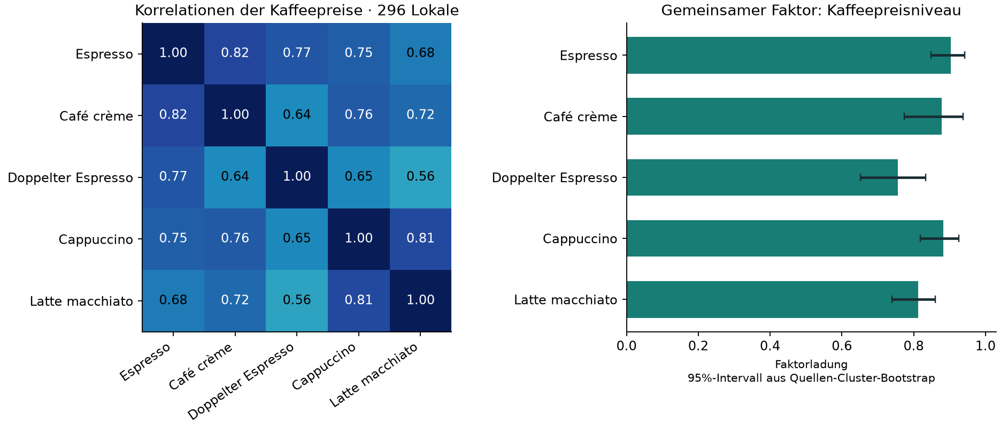
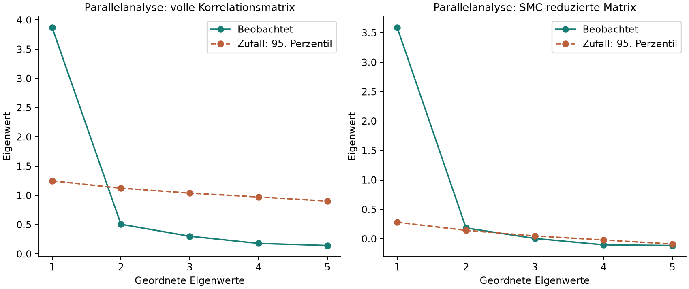
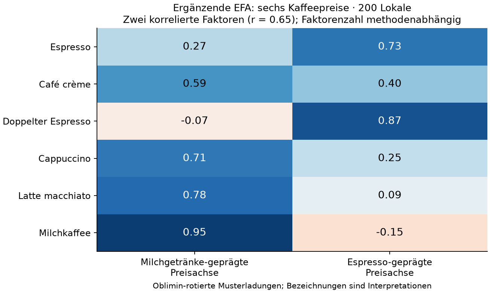

# Explorative Faktorenanalyse der wobillig-Preise

Analyse vom **2. November 2026**. Grundlage: 55 lokale JSON-Datensätze unter `public/data`, mit Dateiprüfsummen in [results.json](results.json). Die Analyse bezieht sich auf den eingecheckten Datenbestand; zusätzliche Einträge im Live-Speicher sind nicht enthalten.

## Ergebnis

**Eine EFA ist vor allem für die Kaffeepreise sinnvoll.** In 296 Lokalen mit fünf gemeinsam erfassten Kaffeesorten zeigt sich ein ausgeprägter gemeinsamer Faktor, den ich als **Kaffeepreisniveau des Lokals** interpretiere. Die Ladungen liegen zwischen 0.755 und 0.904. Der Ein-Faktor-Ansatz bildet **72.0 % der gesamten standardisierten Varianz dieser fünf Preise** ab. Ein Lokal mit einem hohen Preis bei einer Sorte hat häufig auch hohe Preise bei den anderen Sorten.

Bei 200 Lokalen mit zusätzlich erfasstem Milchkaffee ergibt eine ergänzende Zwei-Faktoren-Lösung eine **milchgetränke-geprägte** und eine **espresso-geprägte Preisachse**. Sie korrelieren mit **r = 0.647**. Das ist ein interpretierbarer zusätzlicher Befund, aber keine eindeutig feststehende Faktorenzahl: Zwei Varianten der Parallelanalyse sprechen für unterschiedliche Anzahlen. Die beiden Achsen beschreiben Preiszusammenhänge, keine nachgewiesenen Geschäftsstrategien oder Qualitätsunterschiede.



## Welche Daten eignen sich?

Eine Beobachtung ist ein Lokal, identifiziert durch Stadt und Lokal-ID. Die Merkmale sind Preise für vergleichbare Produkte. Im Repository wurden keine gespeicherten Text-Embeddings oder entsprechende Vektorisierungspipeline gefunden; die hier gebildeten Merkmalsvektoren bestehen aus beobachteten Preisen.

Die fünf verbreitetsten Merkmale jeder Produktfamilie wurden anhand ihrer **Datenabdeckung**, vor Betrachtung der Faktorladungen, ausgewählt. Die Anzahl vollständiger Zeilen ist entscheidender als die Gesamtzahl aller Angebote.

| Datenbereich | Vollständige Lokale | Beurteilung und durchgeführte Analyse |
| --- | ---: | --- |
| Espresso, Café crème, Doppelter Espresso, Cappuccino, Latte macchiato | **296** | Hauptanalyse: fünf kontinuierliche, verständliche Preismerkmale |
| Dieselben fünf Sorten plus Milchkaffee | **200** | Ergänzende EFA mit sechs Merkmalen; Prüfung einer feineren Struktur |
| Fünf Kaffeesorten plus Offenbier 3 dl und 5 dl | **87** | Sekundärpilot; Zwei-Faktoren-Lösung unzulässig, deshalb kein belastbarer allgemeiner Gastro-Index |
| Margherita, Diavola, Tonno, Prosciutto e Funghi, Quattro Stagioni | 45 | Für eine belastbare eigenständige Struktur derzeit zu geringe vollständige Abdeckung; höchstens weitere Pilotanalyse |
| Negroni, Aperol Spritz, Hugo, Espresso Martini, Mojito | 21 | Sehr kleine, selektive vollständige Stichprobe; keine EFA gerechnet |
| Cola, Eistee, Rivella, Fanta, Sprite in 3/3.3 dl | 21 | Sehr kleine Stichprobe; zusätzlich oft gemeinsam ausgezeichnete Preise; keine EFA gerechnet |
| Offenbier 3 dl, Offenbier 5 dl, Flaschenbier 3.3 dl | 102 | Nur drei standardisierte Merkmale: Ein-Faktor-Modell gerade identifiziert, keine aussagekräftige Prüfung zusätzlicher Faktoren; unterschiedliche Marken/Portionen |

Die Fallzahlen sind keine universellen Mindestgrenzen. Ihre Aussagekraft hängt auch von Ladungen, Datenfehlern, gemeinsamen Preisquellen und der Zahl guter Indikatoren pro Faktor ab. Bei Cocktails bleiben ausserdem Varianten und Portionsgrössen eine zusätzliche Vergleichbarkeitsfrage.

Lokaltyp, Stadt, Terrasse, Öffnungszeiten und Erfassungsstatus wurden nicht als beliebig numerisch kodierte EFA-Merkmale vermischt. Sie können später als externe Erklärungsvariablen dienen. Stadt wurde bereits in einer Sensitivitätsanalyse berücksichtigt. Ein Faktor aus Erfassungsmerkmalen würde zudem zunächst das Sammelverfahren beschreiben, nicht zwingend die Lokale.

## Aufbereitung und nachvollziehbare Ausschlüsse

- Pro Lokal und Produkt wurde der **niedrigste gültige erfasste Preis** verwendet, entsprechend der Vergleichslogik des Projekts. Eine Vergleichsrechnung verwendet den Median der verfügbaren Angebote.
- Fehlende Preise wurden **nicht ersetzt**. Jede EFA verwendet vollständig beobachtete Zeilen für ihre jeweiligen Merkmale. Fehlender Preis bedeutet nicht, dass ein Lokal das Produkt nicht anbietet.
- Die Analyse verwendet die Korrelationsmatrix, sodass alle Merkmale auf die gleiche Varianz standardisiert werden. Es gibt keine vorherige PCA.
- Die Standortkataloge wurden nicht als zusätzliche Preisbeobachtungen gezählt, da sie Angebote aus den Kategoriedateien wiederholen können.
- Im Bierpilot wurden nur ausdrücklich als Offenbier gekennzeichnete, alkoholhaltige Angebote mit genau 300 bzw. 500 ml verwendet. Keine Hochrechnung von Portionsgrössen; keine geschätzte Ausschankart. Unterschiedliche Biermarken können weiterhin in die beiden Mindestpreise eingehen.
- Extrempreise wurden in der Hauptanalyse beibehalten. Rangkorrelationen und auf das 1./99. Perzentil begrenzte Werte prüfen ihren Einfluss.

Die folgenden Auffälligkeiten sind aus den gespeicherten Produktnamen, Belegtexten und Quellenpfaden ersichtlich. Es erfolgte keine vollständige Nachprüfung sämtlicher Originalkarten. **Zehn Angebote** wurden vorsorglich aus der Analyse ausgeschlossen, davon sechs Kaffee- und vier Bierangebote:

| Lokal | Gespeicherter Hinweis | Ausschluss |
| --- | --- | --- |
| Da Vinci, Bern | „Café, Espresso Coretto (Grappa)“, CHF 6.90 | Ein alkoholischer Kaffee ist kein normaler Espresso; 1 Angebot |
| dean & david, Basel | Espresso „2“ aus einer Datei namens `Naehrwertuebersicht` | Die Quelle ist offenbar eine Nährwerttabelle; der Wert ist nicht als Preis gesichert; 1 Angebot |
| L'Osteria, Luzern | Quellenpfad `Mallorca-ES`, spanische Belegtexte | Eine ausländische Karte ist keine hinreichende Grundlage für lokale CHF-Preise; 3 Kaffee- und 4 Bierangebote |

Die Hauptstichprobe verkleinert sich dadurch von 297 auf 296 Lokale. Die unbereinigte Vergleichsrechnung liefert einen sehr ähnlichen gemeinsamen Faktor. Alle Ausschlüsse und die Belege stehen in `results.json`; die Preisquellen jeder analysierten Zelle stehen in den `*-provenance.json`-Dateien.


## Hauptanalyse: gemeinsames Kaffeepreisniveau

Die 296 Lokale verteilen sich auf Zürich 127, Bern 67, Basel 44, Winterthur 29, Luzern 15, Lausanne 9 und Genf 5. Über gemeinsame Quellen-URLs, Dateihashes oder Website-Hosts wurden **290 Quellengruppen** gebildet. Diese konservative Gruppierung dient als Näherung für abhängige Beobachtungen, nicht als geprüfte Zuordnung zu Unternehmen.

Die Kaiser-Meyer-Olkin-Kennzahl beträgt **KMO = 0.843**, die Einzelwerte liegen zwischen 0.806 und 0.861. Das spricht für ausreichende gemeinsame Struktur. Bartlett: χ²(10) = 1225.16, nominelles p = 5.39 × 10⁻²⁵⁷. Dieser Test prüft Abweichung von einer Einheitsmatrix, nicht die Zahl oder Bedeutung der Faktoren; Nichtnormalität und Quellenabhängigkeit begrenzen seine inferenzielle Interpretation.

Extrahiert wurde mittels **iterativer Hauptachsenanalyse**, mit quadrierten multiplen Korrelationen als anfänglichen Kommunalitäten. Bei einem Faktor ist keine Rotation erforderlich. Eine unabhängige Maximum-Likelihood-Schätzung konvergierte und wich bei keiner Ladung um mehr als 0.014 ab. Die verwendete Implementierung beschreibt die [statsmodels-Dokumentation](https://www.statsmodels.org/stable/generated/statsmodels.multivariate.factor.Factor.html).

| Preismerkmal | Faktorladung | 95%-Bootstrap-Intervall |
| --- | ---: | ---: |
| Espresso | 0.904 | 0.848–0.942 |
| Café crème | 0.877 | 0.775–0.938 |
| Doppelter Espresso | 0.755 | 0.652–0.833 |
| Cappuccino | 0.883 | 0.818–0.926 |
| Latte macchiato | 0.813 | 0.740–0.861 |

Die Intervalle beruhen auf **1'000 Wiederholungen eines Bootstrap über Quellengruppen**, bedingt auf ein Ein-Faktor-Modell. Alle Wiederholungen lieferten zulässige Lösungen. Der modellierte Varianzanteil beträgt 72.0 %, mit einem Bootstrap-Intervall von 63.0–79.5 %. Gemeint ist die Summe der quadrierten Ladungen, geteilt durch fünf; es handelt sich nicht um einen Anteil des Preises in Franken.

Die mittlere Restabweichung der Korrelationen (RMSR ausserhalb der Diagonale) beträgt **0.052**, die grösste Restkorrelation **0.093** zwischen Cappuccino und Latte macchiato. Ein allgemeiner Faktor fasst die Preise gut zusammen, erfasst aber nicht sämtliche Beziehungen zwischen den Sorten.

### Wie viele Faktoren?

Es wurden **1'000 unabhängige Spaltenpermutationen** durchgeführt, unter Erhalt der beobachteten Randverteilungen. Verglichen wurden die beobachteten Eigenwerte mit dem jeweiligen 95. Perzentil der Zufallsverteilung; behalten werden aufeinanderfolgende führende Eigenwerte oberhalb dieser Schwelle.

| Verfahren | Zweiter beobachteter Eigenwert | Zufallsschwelle für den zweiten Wert | Vorschlag |
| --- | ---: | ---: | ---: |
| Parallelanalyse der vollen Korrelationsmatrix, PC-Variante | 0.506 | 1.123 | 1 Komponente |
| Parallelanalyse der SMC-reduzierten Korrelationsmatrix, FA-Variante | 0.184 | 0.144 | 2 Faktoren |

Diese Ergebnisse sind ausdrücklich **nicht gleichbedeutend**. Die SMC-Variante kann auch kleinere Zusatzstrukturen erfassen; verschiedene Kommunalitätsschätzungen können zu unterschiedlichen Retentionsentscheidungen führen. Das erläutert die [Dokumentation von psych::fa.parallel](https://www.personality-project.org/r/psych/help/fa.parallel.html).

Die zusätzlich gerechnete Zwei-Faktoren-Hauptachsenlösung für die fünf Preise ist **unzulässig**: Die geschätzte spezifische Espresso-Varianz wird negativ (−0.079, ein sogenannter Heywood-Fall). Das ist kein Beweis für exakt einen wahren Faktor. Es verhindert aber, diese Zwei-Faktoren-Lösung als gültiges Ergebnis zu präsentieren. Negative spezifische Varianzen können unter anderem auf Modell- oder Stichprobenprobleme hinweisen; siehe [SAS-Dokumentation zu Heywood-Fällen](https://support.sas.com/documentation/cdl/en/statug/63962/HTML/default/statug_factor_sect022.htm).



### Robustheit des gemeinsamen Faktors

| Vergleichsrechnung, jeweils fünf Kaffeesorten | n | Modellierter Varianzanteil, 1 Faktor |
| --- | ---: | ---: |
| Hauptanalyse | 296 | 72.0 % |
| Ohne die beschriebenen Qualitätsausschlüsse | 297 | 71.1 % |
| Median statt Mindestpreis je Produkt/Lokal | 296 | 71.8 % |
| Logarithmierte Preise | 296 | 70.4 % |
| Rangkorrelationen / Spearman | 296 | 63.2 % |
| Stadtmittel je Sorte herausgerechnet | 296 | 69.8 % |
| Extremwerte auf 1./99. Perzentil begrenzt | 296 | 68.7 % |
| Eine Medianbeobachtung je Quellengruppe | 290 | 72.1 % |
| Nur Zürich | 127 | 78.0 % |
| Ohne Zürich | 169 | 60.2 % |

Die Varianzanteile der transformierten Analysen beziehen sich auf die jeweils transformierten Merkmale und sind nicht vollständig gleichartig. Sie zeigen, dass die gemeinsame Struktur nicht allein durch einzelne Extrempreise, Stadtmittel oder mehrfach verwendete Quellen entsteht. Zusätzlich wurde jede Stadt einzeln weggelassen; alle Ergebnisse stehen in `results.json`.

Die PC-Parallelanalyse schlägt in sämtlichen hier genannten Fünf-Merkmals-Vergleichen eine Komponente vor. Die SMC-FA-Parallelanalyse variiert zwischen einem und drei Faktoren. Damit ist die **dominante gemeinsame Preisdimension** stabiler als die genaue Zahl kleinerer Zusatzdimensionen.

## Ergänzende Analyse: Espresso- und Milchgetränkepreise

Für die sechs Preise einschliesslich Milchkaffee bleiben 200 Lokale in 197 Quellengruppen. KMO = 0.869. Die Ein-Faktor-Lösung bildet 67.0 % der standardisierten Varianz ab, die zulässige Zwei-Faktoren-Lösung **76.6 %**; die Restabweichung RMSR sinkt von 0.074 auf 0.017.

Es wurde eine **schiefwinklige Oblimin-Rotation** verwendet, die korrelierte Faktoren erlaubt. Die folgenden Musterladungen sind gemeinsame Regressionsgewichte auf die Faktoren; bei korrelierten Faktoren sind sie nicht mit einfachen Merkmal-Faktor-Korrelationen gleichzusetzen. Die Strukturmatrix und Faktorkorrelationen stehen ebenfalls in `results.json`.

| Merkmal | Milchgetränke-geprägte Preisachse | Espresso-geprägte Preisachse |
| --- | ---: | ---: |
| Espresso | 0.274 | **0.727** |
| Café crème | 0.591 | 0.397 |
| Doppelter Espresso | −0.074 | **0.872** |
| Cappuccino | **0.714** | 0.249 |
| Latte macchiato | **0.779** | 0.092 |
| Milchkaffee | **0.948** | −0.152 |

Die Faktoren korrelieren mit **r = 0.647**. Café crème lädt auf beiden Achsen; die Benennungen sind deshalb Annäherungen. Das Ergebnis deutet darauf hin, dass Lokale Espresso und Milchgetränke nicht durchgehend im gleichen Verhältnis bepreisen. Die EFA untersucht Unterschiede und Zusammenhänge zwischen Lokalen; dass Milchgetränke im Mittel mehr kosten, wurde durch die Standardisierung nicht selbst als Faktor verwendet.

Die Zwei-Faktoren-Lösung bleibt auch bei Stadtbereinigung, Rangkorrelationen und Aggregation gemeinsamer Quellen zulässig. Im Quellen-Cluster-Bootstrap sind **956 von 1'000 Lösungen zulässig**, 44 unzulässig. Das 95%-Intervall der Faktorkorrelation liegt unter den zulässigen Lösungen bei 0.460–0.775. Diese bedingten Intervalle und die 4.4 % Ausfälle sind zusammen zu betrachten. Zudem hat die Espresso-Achse nur zwei besonders deutliche Indikatoren. Die Parallelanalysen widersprechen einander weiterhin (PC: 1; SMC-FA: 2). Deshalb bleibt die Zweiteilung **eine plausible, zu bestätigende Struktur**.



## Was folgt für wobillig?

Ein über mehrere Kaffeesorten gebildeter **Kaffeepreisniveau-Score** ist durch diese Daten plausibel begründet. Für die 296 vollständig erfassten Lokale sind experimentelle Regressions-Faktorwerte in `coffee5-rows.json` berechnet: höhere Werte bedeuten ein höheres Preisniveau relativ zu dieser Stichprobe. Es sind dimensionslose Modellwerte mit Schätzunsicherheit; sie messen weder Qualität noch Preis-Leistungs-Verhältnis. Für Lokale mit fehlenden Preisen ist die Verwendung dieser Scores noch nicht validiert.

Die zusätzliche Espresso-/Milchgetränke-Struktur könnte später für produktspezifische Vergleiche nützlich sein. Ein Lokal kann relativ preiswerte Espressi anbieten, ohne bei Cappuccino und Latte gleichermassen günstig zu sein. Vor einer Produktfunktion sollten diese Achsen an unabhängig erhobenen oder manuell geprüften Daten bestätigt werden.

Der Pilot mit fünf Kaffeesorten und zwei Biergrössen liefert dagegen **keinen belastbaren allgemeinen Gastro-Preisindex**: n = 87; RMSR des Ein-Faktor-Modells = 0.100, maximale Restkorrelation = 0.287. Die Zwei-Faktoren-Lösung erzeugt erneut eine negative spezifische Varianz (5-dl-Bier: −0.014). Die beiden Biergrössen hängen konstruktionsbedingt eng zusammen und bilden keine breite Abdeckung der Gastronomie. Die exportierten Pilotwerte sind ausschliesslich Diagnostik, keine zur Verwendung empfohlene Rangliste.

## Grenzen der Aussage

Von 759 Lokalen mit mindestens einem akzeptierten Kaffeepreis sind nur **39.0 %** in der Fünf-Merkmals-Analyse enthalten. Deren Espresso-Median beträgt CHF 4.70, gegenüber CHF 4.50 unter allen verfügbaren Espressopreisen. Vollständig erfasste Lokale sind somit eine selektive Teilmenge. Insbesondere Genf und Lausanne sind in der Hauptanalyse schwach vertreten; in der Sechs-Merkmals-Analyse fehlt Genf ganz und Lausanne ist nur einmal vertreten. Eine repräsentative Aussage über die Schweizer Gastronomie oder stabile Vergleiche aller Städte sind damit nicht begründet.

Die Quellen sind automatisch extrahierte oder KI-gelesene Karten mit unterschiedlichen Erfassungsdaten. Ein aktuelles Erfassungsdatum bestätigt nicht die Aktualität der Karte. Rezeptur, Tassengrösse, Servicekontext und Zuordnung zu einem bestimmten Lokal können variieren. Die gezielten Ausschlüsse und Robustheitsanalysen ersetzen keine vollständige Datenprüfung. Korrelationen liefern zudem keine kausale Erklärung für Preisunterschiede.

## Dateien und Reproduktion

- [results.json](results.json): Inventar mit SHA-256-Prüfsummen, Ausschlüsse, Abdeckung, Korrelationen, KMO/Bartlett, beide Parallelanalysen, Ein-/Zwei-Faktoren-Modelle, Sensitivitätsanalysen, Bootstrap und ML-Gegenprüfung.
- [coffee5-rows.json](coffee5-rows.json): Hauptstichprobe, Preise, Quellengruppen und experimenteller Faktorwert.
- [coffee5-provenance.json](coffee5-provenance.json): Belege und URLs der Hauptstichprobe.
- Entsprechende `coffee6-*`- und `coffee_beer7-*`-Dateien: Zusatzanalysen.
- Drei PNG-Abbildungen: Korrelationen/Ladungen, Parallelanalysen und ergänzende Zwei-Faktoren-Lösung.
- [efa.py](../../../scripts/efa.py), [efa-features.mjs](../../../scripts/efa-features.mjs) und [efa-requirements.txt](../../../scripts/efa-requirements.txt): reproduzierbare Extraktion und Berechnung.

Aus dem Repository-Verzeichnis, mit Node >= 22.18 und einer geeigneten Python-Version:

```sh
efa_env=$(mktemp -d /tmp/wobillig-efa.XXXXXX)
python3 -m venv "$efa_env"
"$efa_env/bin/pip" install -r scripts/efa-requirements.txt
"$efa_env/bin/python" scripts/efa.py --as-of 2026-11-02 --output /tmp/wobillig-efa-results
```

Standard: 1'000 Permutationen und 1'000 Bootstrap-Wiederholungen, festgelegte Zufallsseeds. Die Analyse liest lokale Daten und benötigt nach Installation der Abhängigkeiten keine externen API-Aufrufe. Am Ende werden die Quelldatei-Prüfsummen erneut kontrolliert. Neue Rohdaten können andere Ergebnisse liefern; Softwareversionen und Skriptprüfsummen sind in `results.json` dokumentiert. Dieser Bericht beschreibt den hier abgelegten Snapshot.
